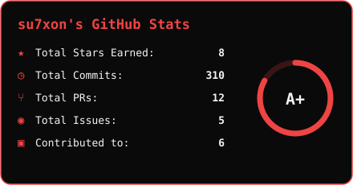
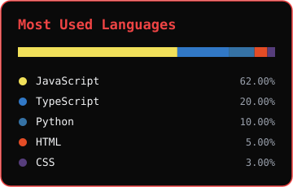
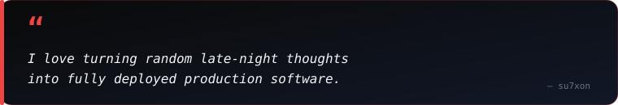
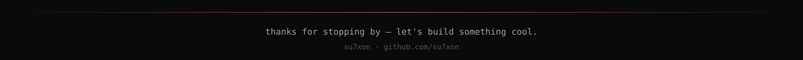

  

  

  
  
  
  
  

  

<h2 align="center">About Me</h2>

  

  

  Hey! I'm <b>Harshit Singh</b> (<b>@su7xon</b>), a <b>Full Stack Developer</b> and Computer Science engineer based in Haldwani, Uttarakhand, India. 
  I build full-stack web platforms, AI/ML &amp; GenAI tools, blockchain experiments, and n8n automations — currently interning at <b>L&amp;T Technology Services</b>.

  
  
  
  

  <b>Let's Discuss:</b> Full Stack, AI/ML, GenAI, Blockchain, n8n &amp; Open Source. 
  <b>Philosophy:</b> <i>"AI can't replace thinking — it can only replace typing."</i>

<table width="100%" border="0" align="center">
  <tr>
    <td width="50%" align="center">
      <h4>Flagship Project</h4>
      
<a href="https://github.com/su7xon/self-healing-rag-system" target="_blank"><b>Self-Healing RAG System</b></a> AI retrieval that fixes its own gaps

    </td>
    <td width="50%" align="center">
      <h4>Active Deep Dives</h4>
      
<b>DSA &amp; System Design</b> React ecosystem &amp; automation

    </td>
  </tr>
  <tr>
    <td width="50%" align="center">
      <h4>Building In Public</h4>
      
<a href="https://github.com/su7xon" target="_blank"><b>@su7xon</b></a> Projects, experiments &amp; code

    </td>
    <td width="50%" align="center">
      <h4>Collaboration</h4>
      
<b>AI, Web &amp; Automation</b> Open to exciting new projects

    </td>
  </tr>
</table>

<h2 align="center">Experience &amp; Achievements</h2>

<table width="100%" border="0" align="center">
  <tr>
    <td width="50%" align="center">
      <h4>Experience</h4>
      
<b>Intern @ L&amp;T Technology Services</b> Backend Developer Intern · 2026 – Present

      
<b>Ex-SDE @ Aspia Infotech</b> Full Stack Development

    </td>
    <td width="50%" align="center">
      <h4>Achievements</h4>
      
<b>5x Hackathon Winner</b> SIH 2025 Finalist · IDE Bootcamp 2026 Winner

      
<b>Open Source Contributor</b> GSSoC · Building NeuroKoon

    </td>
  </tr>
</table>

<h2 align="center">Featured Project Spotlight</h2>

<table width="100%" border="0" align="center">
  <tr>
    <td align="center">
      <h3>Self-Healing RAG System</h3>
      
<i>An AI-powered retrieval-augmented generation system that detects weak answers and repairs its own knowledge gaps — built for reliable, production-style AI workflows.</i>

       
      

        
      

    </td>
  </tr>
</table>

<h2 align="center">Tech Stack &amp; Skills</h2>

<b>Core Programming Languages</b>

  

<b>Frontend &amp; Mobile Development</b>

  

<b>Backend, Cloud &amp; Databases</b>

  

<b>AI, Data Science, Hardware &amp; DevOps</b>

  

  
  
  
  

<h2 align="center">GitHub Analytics &amp; Activity</h2>

<table align="center" border="0">
  <tr>
    <td align="center" valign="top">
      
    </td>
    <td align="center" valign="top">
      
    </td>
  </tr>
</table>

  

  

<h2 align="center">Contribution Journey</h2>

  

  

<h2 align="center">Let's Connect &amp; Collaborate</h2>

<i>Whether you want to discuss system architecture, explore open-source collaboration, or just say hello — my inbox is always open!</i>

<table border="0" align="center">
  <tr>
    <td align="center" width="220">
      <a href="https://github.com/su7xon" target="_blank">
        
          
        
      </a>
       
      <b>Projects &amp; Code</b>
    </td>
    <td align="center" width="220">
      <a href="mailto:ayushsingh0p08@gmail.com">
        
          
        
      </a>
       
      <b>Direct Collaboration</b>
    </td>
    <td align="center" width="220">
      <a href="https://linkedin.com/in/harshit-singh-6b2177362" target="_blank">
        
          
        
      </a>
       
      <b>Professional Network</b>
    </td>
  </tr>
</table>

  

